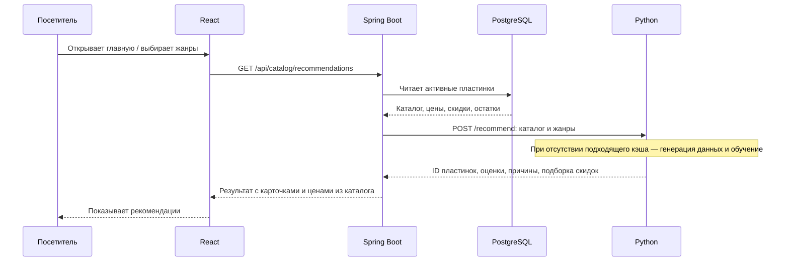

# Нейросеть рекомендаций пластинок SPIN

Этот файл описывает устройство, подключение, запуск и обучение музыкального помощника. Он расположен рядом с основным `README.md` и относится только к модулю рекомендаций.

## Административный прогноз продаж

В `/admin` добавлена кнопка **«ИИ-прогноз продаж ↗»**. Она открывает отдельное окно, не изменяя таблицу каталога и операции с пластинками. Из старой панели `/admin.html` доступна ссылка на `/admin?forecast=1`. API прогноза разрешён только роли `ADMIN`; посетитель без входа получает 401, роли `VIEWER` и `MANAGER` — 403.

В окне показаны прогноз количества проданных пластинок и выручки на следующий календарный месяц, график последних шести месяцев истории и четырёх месяцев прогноза, таблицы с переключением **по годам, месяцам и дням**. Можно отдельно просматривать синтетическую историю и прогноз. Все суммы в рублях и обозначают выручку, а не прибыль.

### Данные и границы периода

Модуль `recommender/forecast.py` независимо генерирует 36 завершённых календарных месяцев ежедневных продаж. История заканчивается последним днём предыдущего месяца. Незавершённый текущий месяц не смешивается с историей: он прогнозируется целиком. Горизонт прогноза — текущий месяц и следующие 12 месяцев.

Например, при открытии в ноябре 2026 года история охватывает ноябрь 2023 — октябрь 2026, прогноз — ноябрь 2026 — ноябрь 2027, а карточка следующего месяца показывает декабрь 2026. Годовые строки содержат только дни внутри этого диапазона, поэтому рядом указано число дней в расчёте. Прогноз за неполный год не выдаётся за прогноз полного года.

Синтетические количества генерируются распределением Пуассона с сезонностью, недельным циклом и ростом спроса. Средняя цена экземпляра также вымышленная, с трендом и небольшим случайным отклонением. Выручка дня равна количеству экземпляров, умноженному на среднюю цену. Seed зависит от даты через SHA-256: один исторический день воспроизводится одинаково при переходе между месяцами. Никакие реальные заказы и цены каталога в эту модель не загружаются.

### Отдельная модель прогноза

Прогноз продаж использует свою небольшую нейросеть **ELM (Extreme Learning Machine)** с 24 скрытыми `tanh`-нейронами и линейными входами для продолжения тренда. Это другая модель, чем описанная ниже сеть рекомендаций пластинок.

Входы — время в годах от 01.01.2020, синус и косинус годового цикла, его вторая гармоника, синус и косинус недельного цикла, признак конца месяца. Периодические признаки проходят через скрытый слой. Веса скрытого слоя фиксируются воспроизводимым генератором, а выходные веса обучаются методом регуляризованной линейной регрессии:

```text
H = [1, X, tanh(X_periodic · W_hidden + b_hidden)]
Y = log(1 + [количество, средняя цена экземпляра])
W_output = solve(HᵀH + λI, HᵀY), λ = 0.2
```

Свободный коэффициент не штрафуется. В этой модели нет эпох и обратного распространения: обучение выходного слоя выполняется решением линейной системы. Поэтому она быстро обучается на ежедневной истории и не требует дополнительных библиотек кроме NumPy. Оба прогноза преобразуются обратно через `expm1`, количество округляется до целых экземпляров, средняя цена — до копеек. Дневная выручка рассчитывается по этим значениям.

Сначала последние **90 дней** истории откладываются для проверки, сеть обучается на более ранних днях и предсказывает отложенный период. Интерфейс показывает MAE — среднюю абсолютную ошибку количества и выручки за день. Это не доверительный интервал и не гарантия точности. Затем отдельная финальная модель обучается на всей доступной истории для прогноза будущего.

Дневные значения суммируются в месячные и годовые: общие количества и суммы согласованы между детализациями. Деньги суммируются в целых копейках. Кэш ограничен двумя месячными результатами; при переходе в новый месяц новый запрос автоматически строит новый прогноз. Перезапуск сервиса очищает кэш. Для обновления открытого окна его можно закрыть и открыть снова.

### Подключение и запуск прогноза

```text
React: SalesForecast.jsx
  → GET /api/analytics/forecast (Spring Boot, только ADMIN)
  → GET /forecast (внутренний Python-сервис)
  → синтетическая история → обучение → ежедневный прогноз → суммы по периодам
```

Контроллер `SalesForecastController.java` не обращается к репозиториям заказов. Он использует тот же адрес `RECOMMENDATIONS_URL`, что и рекомендации. Внешний доступ к Python-порту в Compose не добавляется. При сбое Python окно показывает ошибку и кнопку повтора, остальные операции магазина остаются доступны.

Запуск или обновление после изменений:

```powershell
docker compose --env-file .env -f compose.kr3.yml up -d --build --wait
```

При отдельном запуске Python достаточно перезапустить `python recommender/server.py`, обновить Spring Boot и пересобрать фронтенд. Модуль прогноза входит в существующий контейнер `recommender`; второй Python-сервис не нужен.

Проверки:

```powershell
python -m unittest discover -s recommender/tests -v
.\mvn.cmd -s backend/maven-settings.xml -f backend/pom.xml test
npm.cmd run build --prefix frontend -- --outDir dist
node frontend/test/forecast-browser.mjs
```

Тесты проверяют суммирование по периодам, високосный февраль, переход декабря в январь, воспроизводимость истории, ошибку на отложенных днях, серверные ограничения ролей и изоляцию сбоя. Браузерный тест использует результат настоящей Python-модели с подменой ответов магазина. Прогноз предназначен для учебной демонстрации: вымышленные сезонность и тренд не доказывают качество планирования реального бизнеса.

## 1. Что делает нейросеть

На главной странице магазина есть блок **«В вашем ритме»**. Посетитель выбирает до восьми любимых жанров, а помощник предлагает до трёх пластинок в наличии. При отсутствии выбора он показывает ознакомительную подборку. Выдача учитывает текущую дату и время по Москве.

Модель написана на **Python с NumPy**. Прямой проход, обучение и обновление весов реализованы в проекте. API внешних нейросетей, ChatGPT, GPU и платные ключи для работы не требуются.

Обучающие покупки вымышленные. Они создаются для пластинок текущего каталога и не попадают в реальные заказы, складские остатки или статистику продаж. Личные сведения покупателей и настоящая история заказов в обучение не передаются.

## 2. Как модуль подключён к магазину



React общается с Java-сервером магазина. Java обращается к Python по HTTP и передаёт JSON. Библиотека для запуска Python внутри JVM не нужна: это два отдельных процесса.

Python получает только пять полей каждой активной пластинки: `id`, `genre`, `price`, `discountPercent`, `stock`. Дополнительно передаются выбранные жанры и число рекомендаций. У Python нет подключения к PostgreSQL. Он возвращает ID и оценки, а Java формирует карточки из своего каталога, отбрасывает неизвестные ID, дубликаты и позиции без остатка. Размер скидки и цена берутся из каталога магазина.

Существующие регистрация, авторизация, корзина, оформление заказов, консольное и JavaFX-приложения работают по прежним правилам. Публичный адрес рекомендаций использует уже существующее разрешение на чтение `/api/catalog/**`.

## 3. Где находится код

| Файл | Назначение |
| --- | --- |
| [recommender/neural.py](recommender/neural.py) | Структура сети, прямой проход, обучение, функция ошибки |
| [recommender/model.py](recommender/model.py) | Признаки, вымышленные покупки, кэш модели, ранжирование, календарные названия акций |
| [recommender/server.py](recommender/server.py) | HTTP-сервер, проверка запросов, методы `/recommend` и `/health` |
| [recommender/demo.py](recommender/demo.py) | Экспорт вымышленной истории и примера рекомендаций |
| [recommender/requirements.txt](recommender/requirements.txt) | Зависимость `numpy==2.4.3` |
| [recommender/Dockerfile](recommender/Dockerfile) | Контейнер Python-сервиса |
| [RecommendationController.java](backend/src/main/java/ru/mirea/vinylstore/recommendation/RecommendationController.java) | Публичный API рекомендаций и проверка параметров |
| [RecommendationService.java](backend/src/main/java/ru/mirea/vinylstore/recommendation/RecommendationService.java) | Чтение каталога и обмен с Python |
| [Recommendations.jsx](frontend/src/features/recommendations/Recommendations.jsx) | Блок рекомендаций на главной |
| [preferences.js](frontend/src/features/recommendations/preferences.js) | Сохранение выбранных жанров в браузере |
| [compose.kr3.yml](compose.kr3.yml) | Совместный запуск магазина, базы и нейросети |

## 4. Как запустить

### Через Docker Desktop

Запустите Docker Desktop. Затем откройте терминал в корне проекта, где находятся оба README и `compose.kr3.yml`:

```powershell
docker compose --env-file .env -f compose.kr3.yml up -d --build --wait
```

Используется существующий файл `.env`. В новой копии проекта, если этого файла ещё нет, предварительно выполните `python scripts/init-env.py`.

Магазин доступен по адресу **http://localhost:8080/**, если `APP_PORT` в `.env` не изменён. Python запускается автоматически отдельным сервисом `recommender`. Его порт не опубликован на компьютере: Java обращается к `http://recommender:8091` внутри сети Compose. Локальная установка Python при таком запуске не нужна.

После изменений React-кода повторите команду с `--build`, чтобы работающий контейнер использовал новый интерфейс.

### Python отдельно, без Docker

Нужен Python 3.12 или новее. Команды выполняются из корня проекта:

```powershell
python -m pip install -r recommender/requirements.txt
python recommender/server.py
```

Этот терминал должен оставаться открытым. Сервер начнёт слушать `http://127.0.0.1:8091`. Spring Boot, PostgreSQL и React запускаются отдельно обычным способом, описанным в документации проекта. Для Java нужен JDK 21. Запуск только `server.py` не запускает весь магазин.

Если Spring Boot раздаёт готовый фронтенд, обновите его сборку:

```powershell
npm.cmd run build --prefix frontend
```

### Настройки соединения

| Переменная | Где используется | Значение по умолчанию |
| --- | --- | --- |
| `RECOMMENDATIONS_URL` | Java: адрес Python-сервиса | `http://127.0.0.1:8091` |
| `RECOMMENDER_HOST` | Python: адрес прослушивания | `127.0.0.1` |
| `RECOMMENDER_PORT` | Python: порт | `8091` |

В Compose адрес Java уже заменён на `http://recommender:8091`, а контейнер Python слушает `0.0.0.0`. Если меняете порт при локальном запуске, согласуйте `RECOMMENDER_PORT` с `RECOMMENDATIONS_URL`.

## 5. Когда нейросеть начинает работать

Запуск Python-сервера создаёт объект `Recommender` с пустым кэшем. Обучение в этот момент ещё не выполняется. Проверка `/health` подтверждает доступность HTTP-сервера, а не наличие обученной модели.

Обучение запускается **при первом запросе рекомендаций с непустым каталогом**:

1. React получает каталог магазина и показывает блок помощника на главной.
2. Через 200 мс отправляет запрос с выбранными жанрами. Небольшая задержка позволяет не запускать лишние запросы при быстрых нажатиях.
3. Java читает активные пластинки и передаёт их метаданные в Python.
4. Python сортирует записи по ID, создаёт обучающие примеры, обучает сеть и проверяет её на отложенных примерах.
5. Готовые веса остаются в памяти процесса. Сеть оценивает доступные пластинки для текущего вкуса и времени.
6. React получает результат и отображает карточки.

При пустом активном каталоге Java возвращает пустую подборку без обращения к Python. Если активные записи есть, но все закончились, модель может обучиться, однако рекомендаций для покупки не будет.

Последующие запросы обычно используют готовую сеть. Изменение вкуса посетителя меняет входные данные для прогноза, но не переобучает модель.

## 6. Откуда берутся данные для обучения

Функция `generate_history()` в `model.py` создаёт **4500 вымышленных событий**. Это просмотры с покупкой или без неё. Пример одного события:

```json
{
  "recordId": "00000000-0000-0000-0000-000000000001",
  "occurredAt": "2025-11-23T19:00:00+03:00",
  "genres": ["rock"],
  "quantity": 2
}
```

В генераторе случайно выбираются пластинка, час одного из дней 2025 года и вкусы вымышленного посетителя. Примерно у 25% событий жанры не указаны; у остальных выбран один жанр. Количество равно 0, если покупки не было, или 1–3 при покупке. Среди покупок один экземпляр генерируется чаще двух или трёх.

Вероятность вымышленной покупки задаётся учебной формулой: совпадение жанра повышает интерес, а цена, скидка и временные признаки меняют его. Затем случайный выбор превращает эту вероятность в факт покупки. Формула находится в переменной `demand` и применяется только для создания данных. При выдаче рекомендаций используется обученная сеть.

Первые **3600** событий используются для обучения, оставшиеся **900** — только для измерения ошибки. Отложенные события не участвуют в обновлении весов. Эти части получены из одного генератора и не являются проверкой на реальной истории продаж.

Seed генератора — `23112026`. Для одинакового упорядоченного каталога и настроек он позволяет воспроизводить эксперимент. Внешние CSV-файлы автоматически не загружаются: история создаётся в памяти из текущего каталога.

## 7. Какие признаки получает сеть

Каждая пара «посетитель — пластинка» превращается в массив из 11 чисел. `x[0]` обозначает первое число массива.

| № | Признак | Как рассчитывается |
| --- | --- | --- |
| 1 | Совпадение жанра | 1, если жанр выбран; 0, если не выбран; 0,5, если предпочтения отсутствуют |
| 2 | Наличие предпочтений | 1 при непустом выборе, иначе 0 |
| 3 | Вымышленная популярность | Устойчивое число от 0 до 1, полученное из SHA-256 ID пластинки; это не реальные продажи |
| 4 | Цена | `min(1, log(1 + price) / log(1 + 100000))` |
| 5 | Скидка | `discountPercent / 90` |
| 6 | Месяц и жанр | Косинус положения месяца в годовом цикле со сдвигом, зависящим от жанра |
| 7 | Число месяца и жанр | Косинус положения дня в месяце с учётом длины месяца и сдвига жанра |
| 8 | Час и жанр | Косинус положения часа в суточном цикле со сдвигом жанра |
| 9 | Выходной | 1 для субботы и воскресенья, иначе 0 |
| 10 | Конец месяца | 1 начиная с 25-го числа, иначе 0 |
| 11 | Вечер | 1 начиная с 18:00, иначе 0 |

Сдвиг жанра также получается из SHA-256 и используется для воспроизводимого учебного моделирования сезонного спроса. Он не выведен из исследования музыкальных предпочтений. Текущее время берётся на Python-сервере в фиксированном часовом поясе UTC+3, обозначенном `Europe/Moscow`.

Название альбома, исполнитель, обложка и звукозапись не являются входами сети. Она не слушает музыку и не анализирует аудио. Наличие проверяется отдельно при формировании выдачи.

## 8. Устройство нейросети

Используется полносвязная сеть — многослойный перцептрон (MLP):

```text
11 входных признаков → 16 нейронов с tanh → 1 выход с sigmoid
```

Для одного пакета примеров прямой проход выглядит так:

```text
H = tanh(X · W1 + b1)
p = sigmoid(H · W2 + b2)
sigmoid(z) = 1 / (1 + exp(-z))
```

`X` — входные признаки, `W1` и `W2` — обучаемые веса, `b1` и `b2` — обучаемые смещения. Всего сеть содержит **209 параметров**: 176 весов первого слоя, 16 его смещений, 16 весов выхода и одно выходное смещение.

Веса первоначально задаются случайными числами с фиксированным seed; смещения равны нулю. `tanh` добавляет нелинейность, а `sigmoid` даёт оценку от 0 до 1. В коде аргумент экспоненты ограничивается, чтобы избежать численного переполнения.

Выход используется как оценка интереса для сортировки. Его нельзя трактовать как доказанную вероятность покупки реальным человеком: модель учится на вымышленных событиях с весами, зависящими от количества экземпляров.

## 9. Как происходит обучение

Метод `NeuralNetwork.train()` выполняет **100 эпох**. Эпоха — один проход по всей обучающей части.

1. Из количества `quantity` получается целевая метка `y`: 1 при покупке, 0 при отсутствии покупки.
2. Вес примера равен `max(1, quantity)`. Покупка трёх экземпляров имеет вес 3; отсутствие покупки — вес 1.
3. В начале каждой эпохи обучающие примеры перемешиваются.
4. Они делятся на мини-пакеты до 128 примеров. Для 3600 событий получается 29 пакетов за эпоху.
5. Сеть рассчитывает прогнозы пакета прямым проходом.
6. Вычисляются градиенты взвешенной бинарной кросс-энтропии; ошибка передаётся от выхода к скрытому слою методом обратного распространения.
7. Веса и смещения обновляются градиентным спуском.

Функция ошибки:

```text
w = max(1, quantity)
L = sum(w · (−y · ln(p) − (1 − y) · ln(1 − p))) / sum(w)
```

В коде производная по входу sigmoid равна `(p − y) · w / sum(w)` для текущего пакета. Для скрытого слоя она умножается на веса выходного слоя и производную `tanh`, равную `1 − H²`. Градиенты обоих слоёв вычисляются до изменения весов.

Скорость обучения постепенно уменьшается:

```text
learning_rate = 0.12 / (1 + epoch · 0.015)
parameter = parameter − learning_rate · gradient
```

Нумерация эпох начинается с нуля. Используется обычный градиентный спуск по мини-пакетам, без Adam, momentum или автоматической остановки. Все 100 эпох выполняются полностью.

После обучения метод `loss()` измеряет ошибку на 900 отложенных событиях. Это значение возвращается в API как `training.validationLoss`. Оно не используется для выбора лучшей эпохи и само по себе не выражает точность в процентах. Чем меньше эта ошибка при одинаковом наборе данных и способе расчёта, тем лучше модель предсказывает соответствующие учебные события.

Количество влияет на вес примера. Модель не предсказывает отдельным выходом, сколько экземпляров купят; её задача — ранжирование пластинок по интересу.

## 10. Как получается итоговая подборка

После обучения или загрузки модели из памяти Python оставляет кандидатов с `stock > 0`. Для каждого строятся признаки с текущими жанрами и временем, вычисляется оценка сети. Кандидаты сортируются по убыванию оценки, а при равенстве — по ID. Возвращаются первые `limit` записей; интерфейс запрашивает три.

Причина под карточкой формируется из шаблона: совпадение с жанром, ознакомительная подборка или предложение нового звучания. Это не отдельная языковая модель и не подробное объяснение вклада каждого нейрона.

Если подходящих жанров нет, могут появляться другие жанры. Вкусы влияют на оценку, но не действуют как строгий фильтр. Без выбранных жанров включается режим `DISCOVERY`; с выбором — `PERSONALIZED`.

## 11. Кэш и повторное обучение

В Python хранится одна последняя модель вместе с описанием каталога. Описание включает ID, жанр, цену и скидку каждой записи. Если эти данные не изменились, используются прежние веса.

Переобучение произойдёт на следующем запросе после изменения состава активного каталога, жанров, цен или скидок. При перезапуске Python-процесса кэш также исчезает. Файл готовых весов на диск не записывается.

Остаток, выбранные жанры посетителя, дата и час не входят в ключ кэша. Их изменения влияют на кандидатов или входные признаки при прогнозе, но сами по себе не запускают обучение. Настоящая покупка изменяет остатки магазина, однако не добавляет обучающий пример. Изменение имени, обложки или исполнителя также не требует переобучения.

Блокировка в `_model_for()` защищает создание модели от одновременного обучения несколькими запросами. После изменения Python-кода перезапустите Python-сервис: автоматического наблюдения за исходниками нет.

## 12. Как учитываются время и акции

Время влияет на числовые признаки сети и, следовательно, на ранжирование. На открытой главной странице React раз в минуту проверяет смену часа и при её наступлении запрашивает новую подборку. Новые запросы также выполняются при смене жанров, обновлении каталога в состоянии React, повторном открытии блока и нажатии кнопки повтора после ошибки.

Для акций из общего рейтинга выбирается до трёх пластинок с уже существующей скидкой `discountPercent > 0`. Название назначается календарным правилом, в следующем порядке приоритета:

| Условие | Название |
| --- | --- |
| 20–31 декабря | Пластинки к Новому году |
| Начиная с 25-го числа любого другого применимого периода | Находки конца месяца |
| Суббота или воскресенье | Виниловые выходные |
| После 18:00 или до 06:00 | Пластинки для вечернего прослушивания |
| Остальные случаи | Выгодные находки дня |

Подбор товаров ранжируется нейросетью, название задаётся обычными условиями. Сеть **не назначает новые проценты скидок**, не меняет срок действия акции и не записывает цены в базу. Если скидок на доступные товары нет, блок акции не показывается. Итоговую стоимость заказа рассчитывает существующий код магазина; обновление цен администратором по-прежнему возможно.

## 13. Где хранятся вкусы пользователя

Выбор сохраняется в `localStorage` текущего браузера под ключом:

```text
spin-recommendations:v1:<ID пользователя>
spin-recommendations:v1:guest
```

При смене аккаунта React создаёт новый экземпляр блока, чтобы не показывать вкус предыдущего аккаунта. Гостевой профиль общий для гостей этого браузера. Настройки не синхронизируются между устройствами. Если хранилище недоступно, выбор работает в памяти открытой страницы.

В Python передаются сами жанры, но не ID аккаунта. Избранное, корзина и реальные заказы не используются для автоматического определения вкуса. При новом посетителе без выбора жанров персональных сведений у модели нет.

## 14. API и обработка ошибок

Публичный запрос к Java:

```text
GET /api/catalog/recommendations?genres=Rock&genres=Jazz&limit=3
```

Допустимы до восьми жанров длиной до 50 символов и `limit` от 1 до 12. Ответ содержит `items`, `promotion`, `training`, `mode`, `dataSource: SYNTHETIC`, `generatedAt`, `timeZone`. Некоторые необязательные поля при пустом каталоге отсутствуют. Статистика обучения остаётся в API, хотя раскрывающийся блок «Как работает подборка» удалён с главной страницы.

Внутренний запрос Java к Python:

```json
{
  "records": [
    {
      "id": "00000000-0000-0000-0000-000000000001",
      "genre": "Rock",
      "price": 2500,
      "discountPercent": 20,
      "stock": 5
    }
  ],
  "genres": ["rock"],
  "limit": 3
}
```

Он отправляется на `POST /recommend`. Python проверяет структуру, UUID, уникальность ID, неотрицательные остатки, цену и скидку. Размер тела ограничен 2 МиБ, каталог — 10000 записями. Проверка доступности выполняется через `GET /health`.

Java ждёт соединения до 2 секунд и ответа до 15 секунд. React отменяет свой запрос через 20 секунд или при смене параметров/закрытии блока. Некорректные публичные параметры дают HTTP 400. Недоступность Python или некорректный ответ дают HTTP 503 для метода рекомендаций. Интерфейс показывает сообщение и кнопку повтора, а обычный каталог продолжает работать. Автоматической подмены ответа выдуманной успешной подборкой нет.

Логи Docker:

```powershell
docker compose --env-file .env -f compose.kr3.yml logs --tail=100 backend recommender
```

Проверка Python при отдельном локальном запуске:

```powershell
Invoke-RestMethod http://127.0.0.1:8091/health
```

В стандартном Docker-запуске этот локальный адрес недоступен с хоста, поскольку порт Python не опубликован. Для него используйте статус и логи Compose.

## 15. Как посмотреть вымышленные покупки

Для демонстрации без запущенного магазина:

```powershell
python recommender/demo.py --sample
```

Для генерации истории на текущем каталоге работающего магазина:

```powershell
python recommender/demo.py --shop http://127.0.0.1:8080
```

Скрипт записывает `exports/recommendations-demo.json`: каталог, все 4500 событий, пример рекомендаций и статистику обучения. Путь можно изменить параметром `--output`. Показанный выше пример одного события иллюстрирует формат; конкретные события создаёт генератор.

Экспорт является результатом отдельного демонстрационного запуска. Сервер не читает этот файл автоматически, а редактирование JSON не переобучает работающую модель. Для изменения характера учебных покупок меняйте `generate_history()` в `model.py` и перезапускайте сервис.

## 16. Проверки и ограничения

Команды из корня проекта:

```powershell
python -m unittest discover -s recommender/tests -v
npm.cmd test --prefix frontend
.\mvn.cmd -s backend/maven-settings.xml -f backend/pom.xml test
```

Python-тесты проверяют обучение на отложенных событиях, изменение выдачи по вкусу и времени, воспроизводимость данных, кэш, отсутствие товаров, HTTP API и проверку входных данных. Java-тесты проверяют адаптер, сохранение цен и доступность каталога при сбое Python. Тесты фронтенда проверяют сохранение предпочтений, разделение аккаунтов и формирование запроса.

Дополнительная браузерная проверка с работающим Python и тестовым каталогом:

```powershell
npm.cmd run build --prefix frontend -- --outDir dist
node frontend/test/recommendations-browser.mjs
```

Для неё нужны Edge или Chrome (`PLAYWRIGHT_CHANNEL=chrome`), зависимости фронтенда и Python в PATH. Другой путь к Python задаётся через `RECOMMENDER_PYTHON`. Тест подменяет ответы магазина, чтобы не создавать реальные заказы и пользователей.

Модель демонстрирует процесс рекомендаций на искусственных закономерностях. Хорошая ошибка на таких данных не доказывает качество на реальных покупателях. Генератор обучает на одном выбранном жанре или без выбора, тогда как интерфейс допускает несколько; отдельной оценки качества на реальных профилях с несколькими жанрами пока нет. Текущая сеть также не обучается на действиях пользователя в реальном времени.

Для дальнейшего развития потребуются отдельный механизм сбора событий, подготовка настоящих обучающих данных, проверка качества на независимых пользователях и периодах, сохранение версий весов и управляемое переобучение. Автоматическое назначение скидок потребует самостоятельной серверной логики и согласования с расчётом заказа — сейчас этой функции нет.
